# Guía de uso · Trabajador

**App de Marcación · Full Service & Clean**

Con esta app marcás tu jornada desde el teléfono: ingreso, traslado al lugar de trabajo, llegada, foto del equipo de seguridad, almuerzo, regreso y salida. Es rápida: cada paso es un botón.

> Los nombres y horarios de las capturas son de ejemplo.

---

## 1. Antes de empezar

| Qué necesitás | Detalle |
|---|---|
| Un usuario | El mismo usuario y contraseña de Full Service. Si no lo tenés, pedilo a administración. |
| Tu rostro enrolado | Administración lo registra una sola vez, con vos presente. No se guarda ninguna foto de tu cara: solo una huella numérica. |
| Teléfono con cámara frontal y GPS | Cuando el navegador te pregunte, tocá **Permitir** para la **cámara** y la **ubicación**. |
| Conexión a internet | Datos móviles o Wi-Fi. |

## 2. Instalar la app en el teléfono

Se instala una sola vez y queda como un ícono más, sin tienda de aplicaciones.

**Android (Chrome)**

1. Abrí la dirección de la app en Chrome (te la pasa administración).
2. Tocá el menú **⋮** (arriba a la derecha).
3. Elegí **Agregar a pantalla de inicio** o **Instalar aplicación**.

**iPhone (Safari)**

1. Abrí la dirección de la app en **Safari** (no en otro navegador).
2. Tocá el botón **Compartir** (el cuadrado con la flecha).
3. Elegí **Agregar a inicio**.

Después abrí la app desde el ícono **Marcación**.

## 3. Iniciar sesión

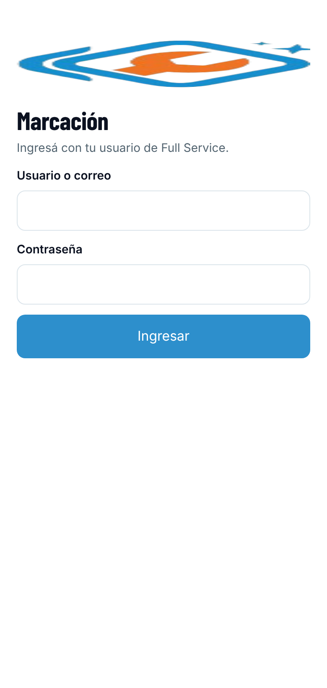

Escribí tu usuario y contraseña y tocá **Ingresar**. La sesión queda abierta; si te pide ingresar de nuevo, es normal pasadas varias horas.

---

## 4. Tu jornada, paso a paso

En la parte de arriba hay una **barra de progreso** con 6 tramos: te muestra en qué paso vas. Abajo siempre hay **un botón principal** que dice qué toca hacer.

### Paso 1 · Marcar el ingreso (con rostro)

| | |
|---|---|
| 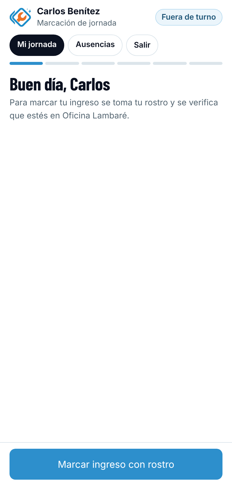 | **Dónde:** en la oficina.  1. Tocá **Marcar ingreso con rostro**. 2. La cámara se abre. Mirá al frente, con buena luz y sin gorra ni lentes oscuros. 3. La app te pide un gesto: **parpadear** o **girar la cabeza**. Hacelo con naturalidad; sirve para comprobar que sos vos y no una foto. 4. Cuando termine, el ingreso queda marcado.  Si no estás dentro del radio de la oficina, normalmente la app no te deja marcar. |
| 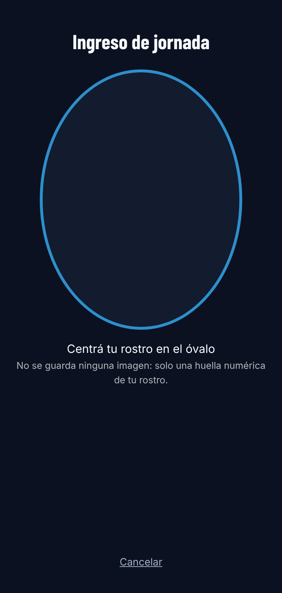 | **Importante:** no se guarda ninguna imagen de tu cara. La app solo compara una huella numérica con la que registró administración. |

### Paso 2 · Elegir a dónde vas y salir

| | |
|---|---|
| 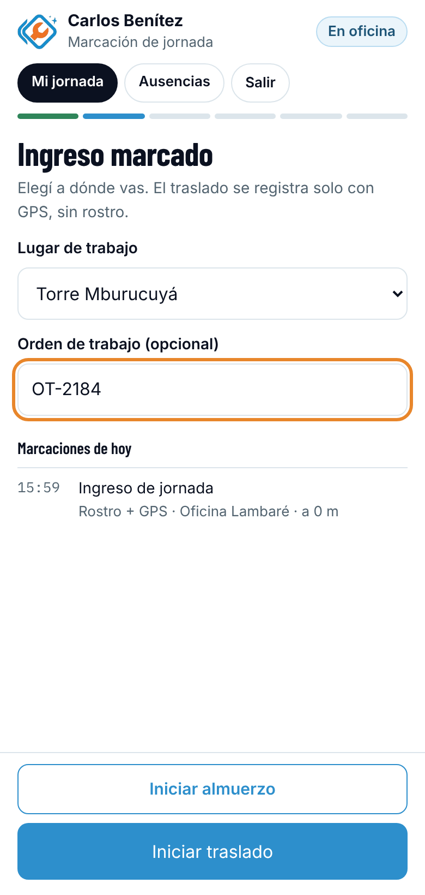 | 1. En **Lugar de trabajo** elegí el lugar de la lista. 2. Si tenés una orden de trabajo, escribila en **Orden de trabajo** (por ejemplo `OT-2184`). Es opcional. 3. Tocá **Iniciar traslado**.  El traslado se registra solo con GPS, sin rostro. |

### Paso 3 · Viajar y marcar la llegada

| | |
|---|---|
| 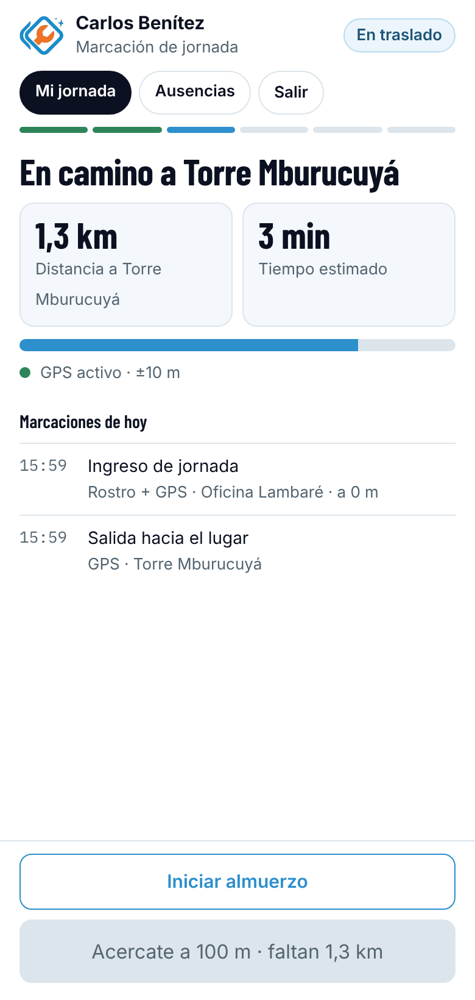 | Durante el viaje la app muestra **cuánto falta** y el tiempo estimado. Dejá la ubicación (GPS) activada.  El botón de abajo está apagado hasta que estés a **menos de 100 m** del lugar (el radio exacto lo define administración). Cuando llegás, se enciende. |
| 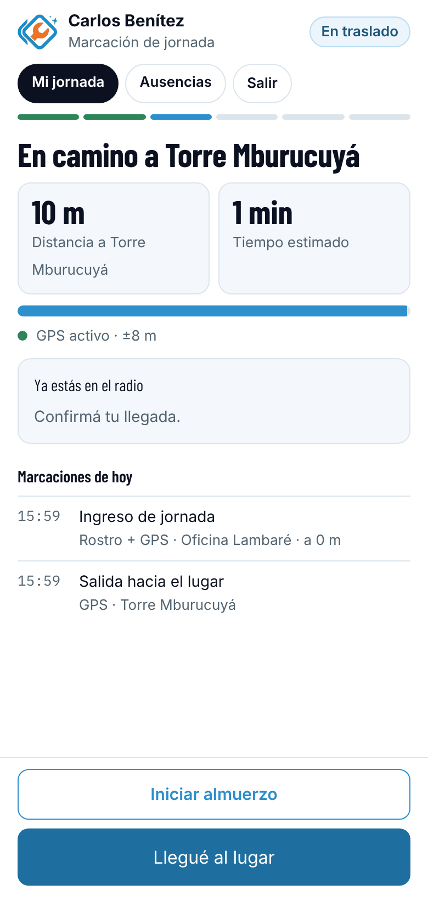 | Tocá **Llegué al lugar**. Si todavía estás lejos, la app te dice a cuántos metros estás. |

### Paso 4 · Foto del equipo de seguridad (obligatoria)

Antes de empezar a trabajar tenés que mostrar que llevás el equipo de seguridad puesto, y un encargado lo aprueba.

| | |
|---|---|
| 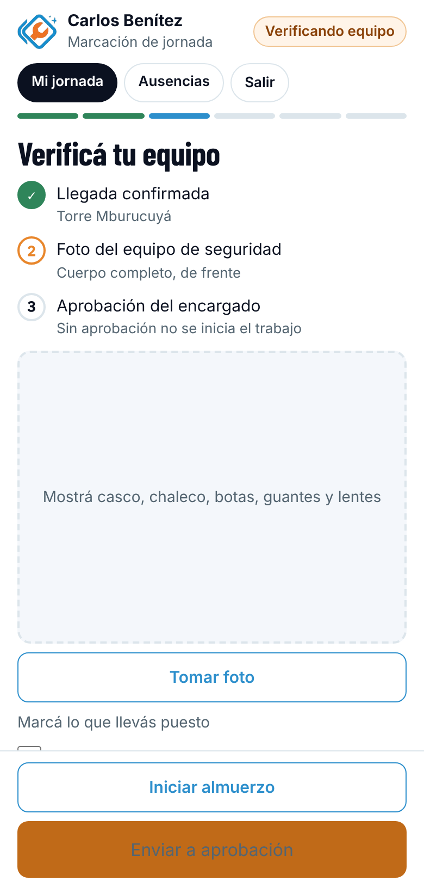 | 1. Tocá **Tomar foto**. 2. Sacate una foto **de cuerpo completo, de frente**, con todo el equipo puesto: casco, chaleco reflectivo, botas de seguridad, guantes y lentes de protección. 3. Si te salió mal, tocá **Tomar otra foto**. |
| 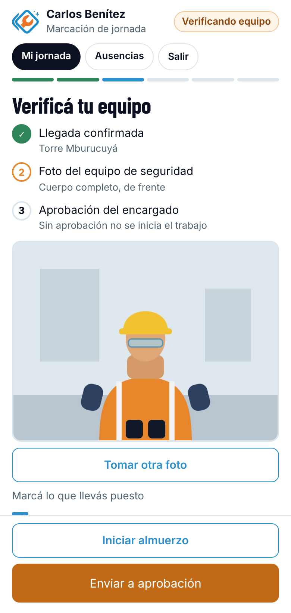 | 4. En **Marcá lo que llevás puesto**, tildá cada elemento que realmente tenés puesto. 5. Tocá **Enviar a aprobación**.  No tildes lo que no llevás: el encargado lo compara con la foto. |

### Paso 5 · Esperar la aprobación

| | |
|---|---|
| 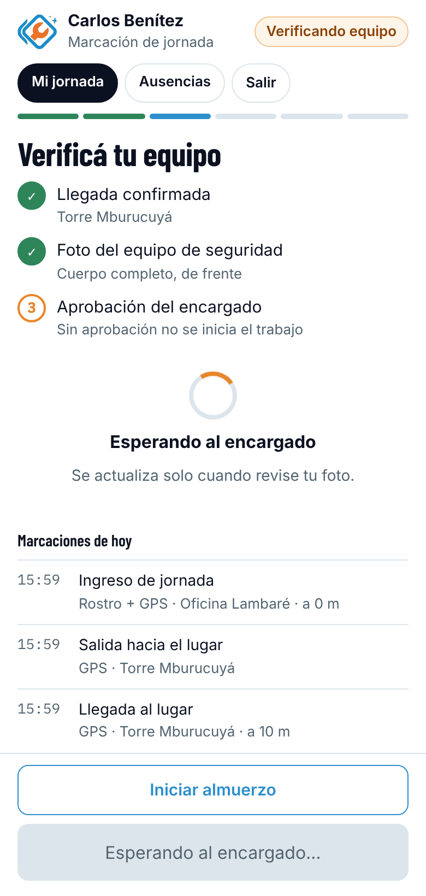 | La pantalla dice **Esperando al encargado** y se actualiza sola cuando responde. No hace falta cerrarla ni recargarla.  - Si **aprueba**, pasás a trabajar. - Si **rechaza**, te muestra el motivo (por ejemplo, falta el chaleco). Corregí y volvé a enviar la foto.  Mientras no esté aprobado no podés iniciar el trabajo. |

### Paso 6 · Trabajando en el lugar

| | |
|---|---|
| 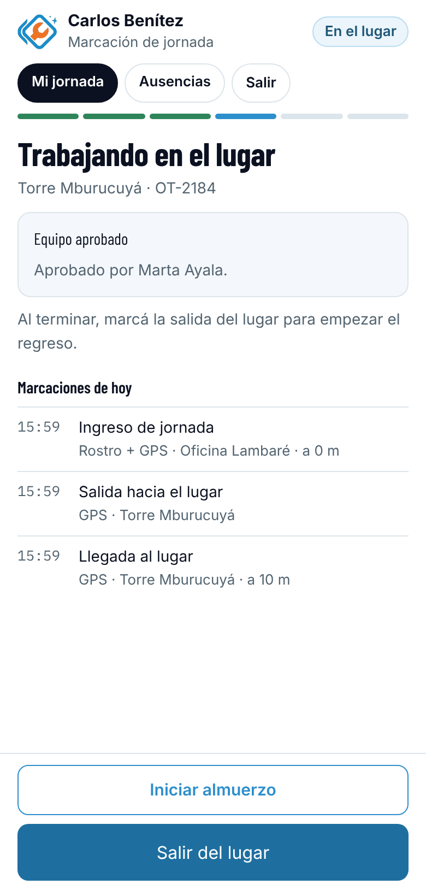 | Con el equipo aprobado ya estás trabajando. Cuando termines, tocá **Salir del lugar**: eso empieza el viaje de regreso. |

### Paso 7 · Regresar y marcar la llegada a la oficina

| | |
|---|---|
| 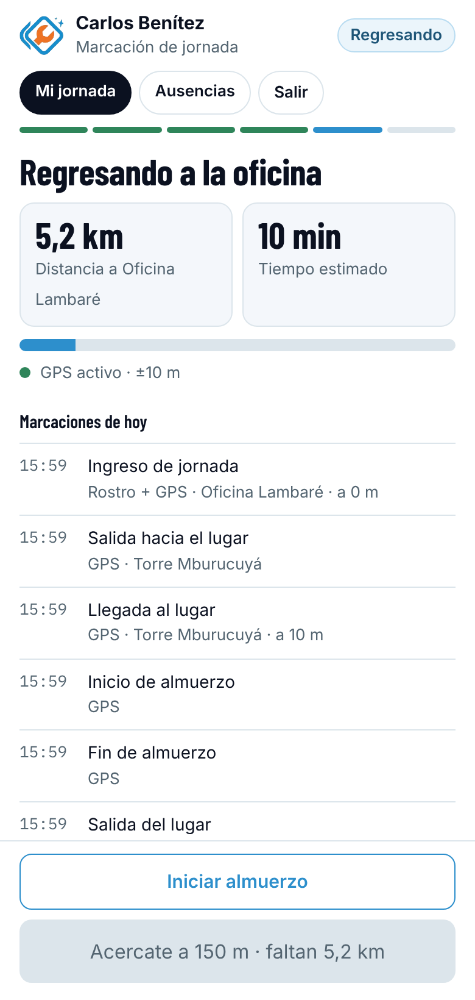 | Igual que a la ida: la app muestra la distancia y habilita **Llegué a la oficina** cuando estás dentro del radio. |

### Paso 8 · Marcar la salida (con rostro)

| | |
|---|---|
| 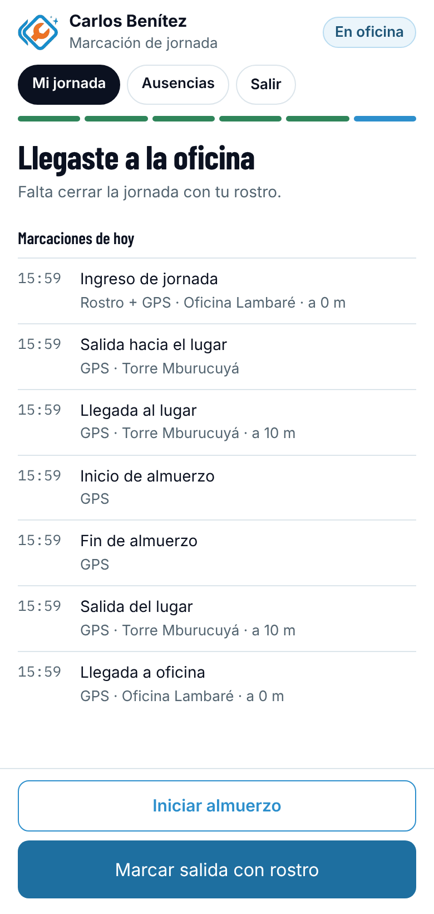 | En la oficina tocá **Marcar salida con rostro** y hacé lo mismo que al ingresar: mirar al frente y hacer el gesto que te pida. Con eso cierra la jornada. |
| 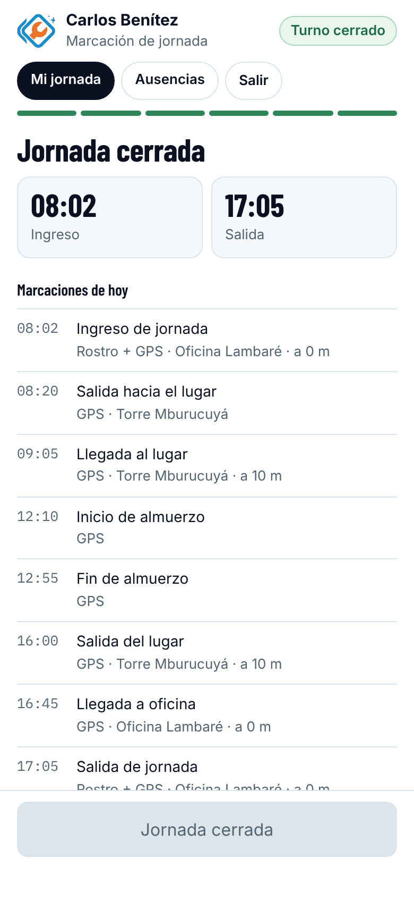 | Al final ves **Jornada cerrada**, tus horas de ingreso y salida y el detalle de todas tus marcaciones del día. |

---

## 5. Almuerzo

El almuerzo se marca **en cualquier momento de la jornada** (no importa el paso en que estés).

| | |
|---|---|
| 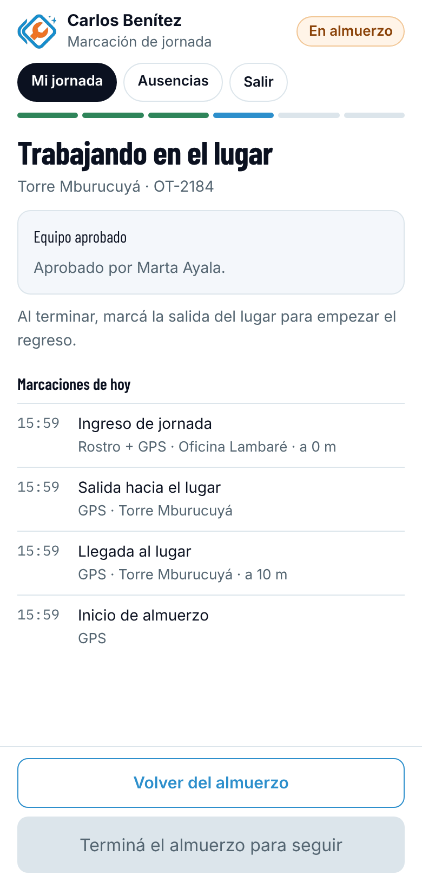 | 1. Tocá **Iniciar almuerzo** (botón blanco, arriba del botón principal). 2. Mientras estás de almuerzo, el botón principal queda apagado: **Terminá el almuerzo para seguir**. 3. Al volver, tocá **Volver del almuerzo**.  Si no marcás el almuerzo, el sistema descuenta automáticamente el tiempo previsto (normalmente 60 minutos) en jornadas largas. |

---

## 6. Vacaciones, permisos y reposos

Entrá a **Ausencias** (menú de arriba).

| | |
|---|---|
| 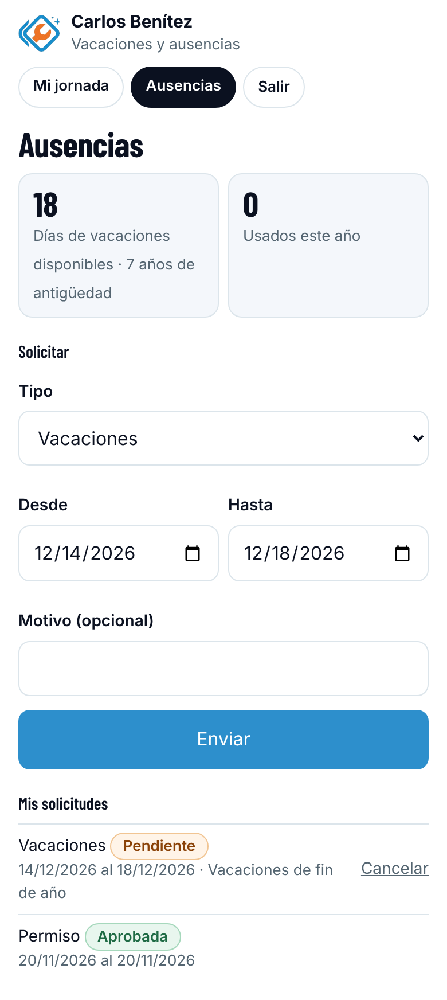 | - Arriba ves tus **días de vacaciones disponibles** y cuántos usaste este año. - Para pedir una ausencia: elegí el **Tipo** (vacaciones, permiso, reposo médico o licencia), las fechas **Desde** y **Hasta**, un motivo (opcional) y tocá **Enviar**. - La solicitud queda **Pendiente** hasta que un encargado la apruebe. Verás **Aprobada** o **Rechazada** (con el motivo). - Podés **Cancelar** una solicitud mientras esté pendiente. - No se puede pedir un período que se superpone con otro ya pedido. |

Las faltas sin aviso **no se cargan acá**: el sistema las detecta solo cuando no marcás un día laborable.

---

## 7. Si algo no funciona

| Qué pasa | Qué hacer |
|---|---|
| **"La precisión del GPS es baja"** | Salí a un lugar abierto, esperá unos segundos y probá de nuevo. Activá la ubicación de alta precisión. |
| **El botón de llegada no se enciende** | Todavía estás fuera del radio. Mirá la distancia en pantalla y acercate. Verificá que el GPS esté activado. |
| **"No pudimos confirmar que seas vos"** | Mirá de frente, con buena luz, sin gorra ni lentes oscuros, y probá de nuevo. Si te rechaza varias veces seguidas, avisá a administración: puede hacer falta volver a enrolar tu rostro. |
| **"Todavía no tenés tu rostro enrolado"** | Pedile a administración que lo registre. Según cómo esté configurado, podés marcar igual (la marca queda señalada como *sin rostro enrolado*) o no podrás marcar hasta que te enrolen. |
| **La cámara no abre** | Permití el acceso a la cámara en los ajustes del navegador (candado junto a la dirección) y tocá **Reintentar**. |
| **Sin señal** | Hace falta conexión para marcar. Buscá señal e intentá de nuevo. |
| **Me olvidé de marcar la salida** | Avisá a tu encargado o a administración. En el reporte queda como **Sin salida** y se corrige con administración (hoy no se arregla desde la app). |
| **El encargado no aprueba mi foto** | Avisale en persona o por el medio habitual. Mientras no aprueba, no podés iniciar el trabajo. |
| **No tengo el equipo completo** | No lo tildes ni lo ocultes: la foto se rechaza. Hablá con tu encargado antes de empezar. |
| **Perdí el teléfono o cambié de equipo** | Iniciá sesión en el nuevo con tu usuario. Si querés cambiar de dispositivo para el rostro, administración puede enrolarte de nuevo. |

## 8. Preguntas frecuentes

**¿Se guarda una foto de mi cara?** No. Solo se guarda una huella numérica, que se borra si dejás de ser funcionario.

**¿La app me sigue todo el día?** No. Usa el GPS solo para marcar y mientras estás en traslado, para mostrarte la distancia.

**¿Puedo marcar por un compañero?** No. Cada marca de ingreso y salida verifica tu rostro y el sistema registra la ubicación.

**¿Qué pasa si llego tarde?** Se descuenta una tolerancia (normalmente 10 minutos); pasada esa tolerancia queda registrada la tardanza.

**¿Puedo usar la app desde el navegador sin instalarla?** Sí, funciona igual; instalarla solo la deja más a mano.
