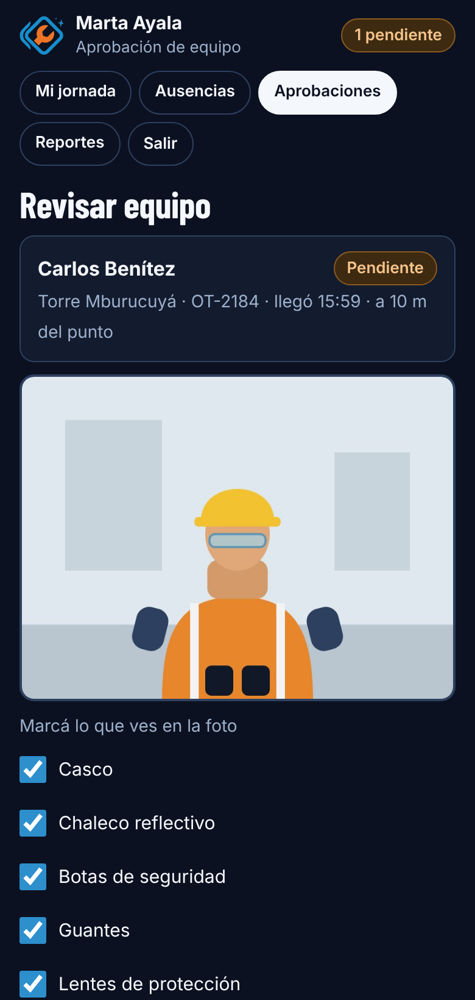
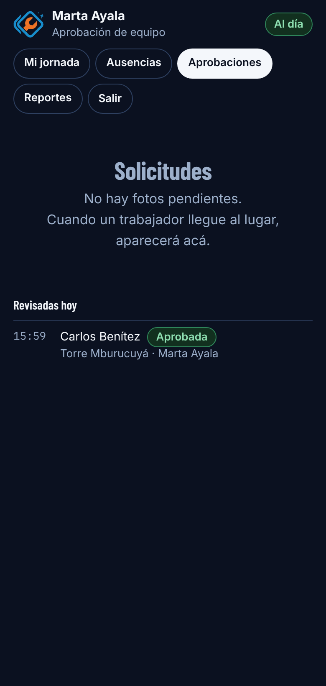
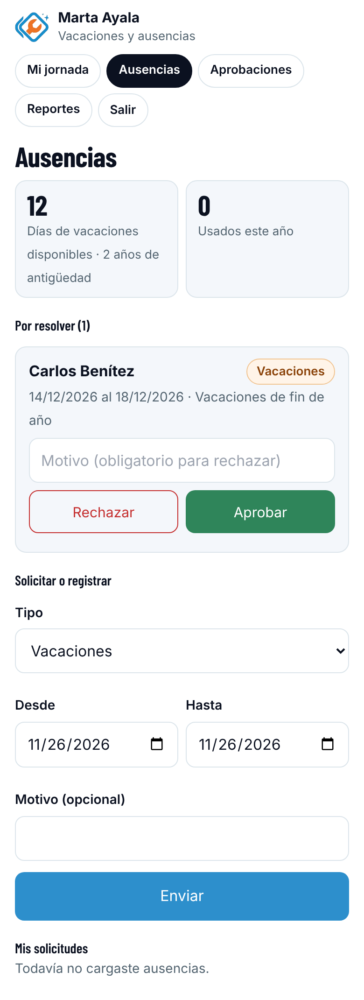
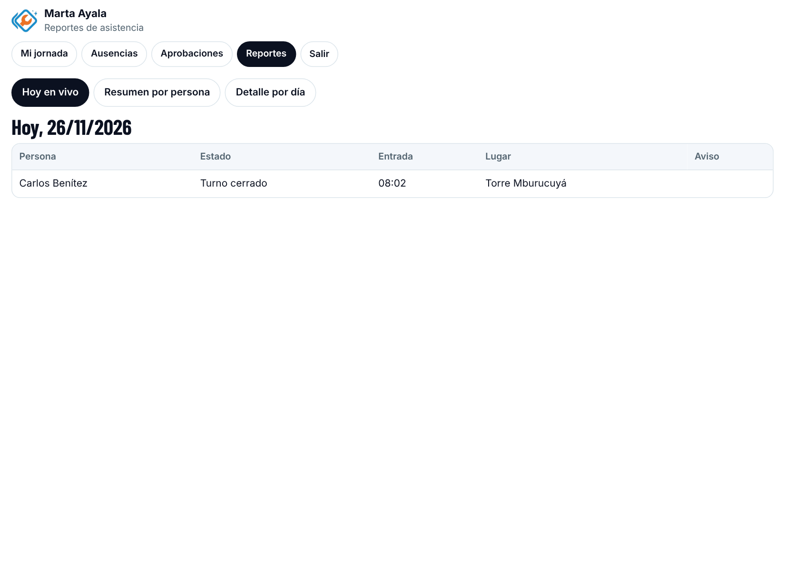
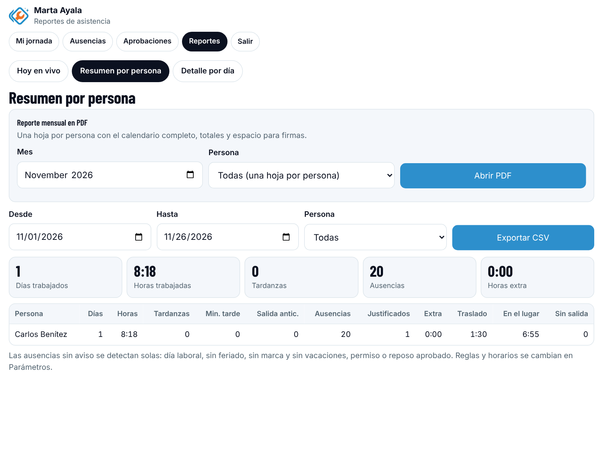
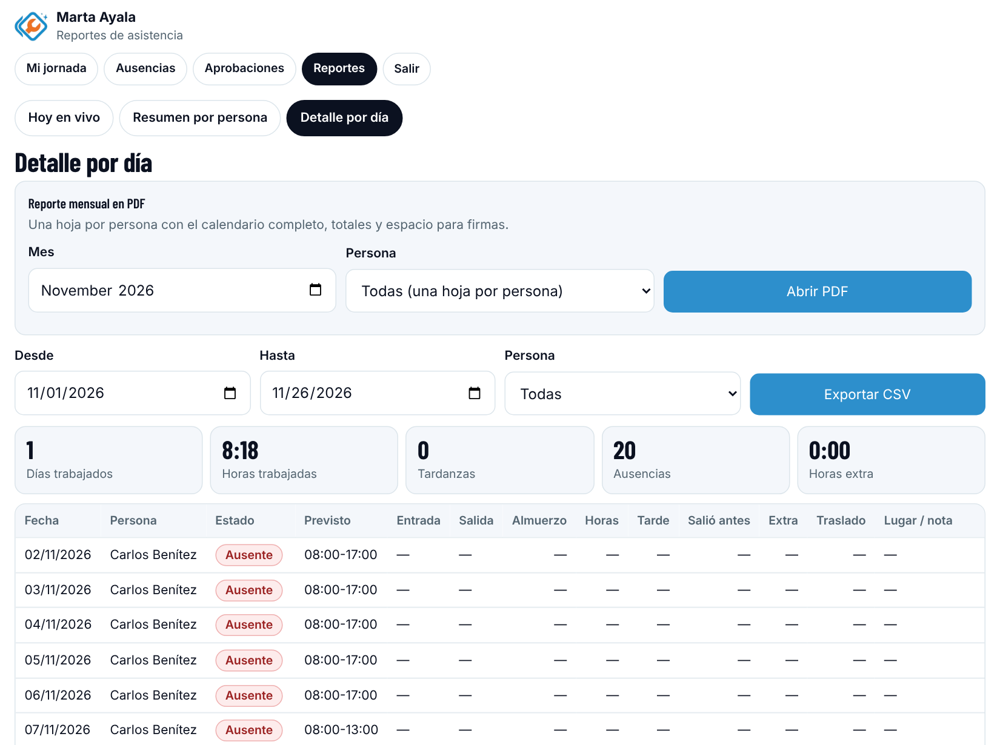

# Guía de uso · Encargado

**App de Marcación · Full Service & Clean**

Como encargado hacés tres cosas: **aprobar el equipo de seguridad** de tu gente antes de que empiece a trabajar, **resolver ausencias** (vacaciones, permisos, reposos) y **mirar los reportes** de asistencia.

> Los nombres, fotos y horarios de las capturas son de ejemplo.
> Para ver estas pantallas tu usuario necesita un rol con permiso de aprobar y de ver reportes (administrador, administración, gerencia o planner). Si no ves un botón del menú, pedí el permiso a administración.

El menú de arriba muestra: **Mi jornada · Ausencias · Aprobaciones · Reportes** (y **Parámetros / Sitios** solo si sos administrador). Tu propia jornada se marca igual que la de cualquier trabajador (ver *Guía del trabajador*).

---

## 1. Aprobar el equipo de seguridad

Cuando un trabajador llega al lugar y envía la foto de su equipo, te aparece en **Aprobaciones** con el aviso **1 pendiente** en la esquina. La pantalla se actualiza sola cada pocos segundos.

| | |
|---|---|
|  | 1. Entrá a **Aprobaciones**. 2. Arriba ves **quién es**, el **lugar**, la orden de trabajo, la hora a la que llegó y a cuántos metros del punto. 3. Mirá la **foto**: tiene que verse a la persona de cuerpo completo. 4. Debajo, **Marcá lo que ves en la foto**. Vienen tildados los elementos que el trabajador dice llevar; **vos confirmás o corregís** según la foto. 5. Decidí. |

### Qué tiene que verse

Casco · chaleco reflectivo · botas de seguridad · guantes · lentes de protección.

Los elementos que el trabajador **no declaró** aparecen con la nota *no declarado*.

### Aprobar

Si ves **los cinco elementos**, dejá todo tildado y tocá **Aprobar**. El trabajador recibe el aviso en su pantalla y puede empezar a trabajar.

> El botón **Aprobar** solo se enciende si todos los elementos están tildados. No se puede aprobar un equipo incompleto.

### Rechazar

1. Destildá lo que **no** ves en la foto. Si faltan elementos, el sistema usa ese dato como motivo (por ejemplo, *Falta: chaleco reflectivo*).
2. Si el problema es la foto en sí, elegí un motivo: **Foto borrosa**, **Foto incompleta** o **Equipo dañado**.
3. Tocá **Rechazar**.

El trabajador ve el motivo y puede volver a enviar la foto.

| | |
|---|---|
|  | Después de resolver, la solicitud pasa a **Revisadas hoy** con su resultado y el nombre de quien la resolvió. Si hay más fotos en espera, aparece la siguiente. |

**Reglas que conviene saber**

- **No podés aprobar tu propia foto**; la tiene que revisar otro encargado.
- Si dos encargados abren la misma foto, la primera decisión vale y al otro le avisa que *ya fue resuelta*.

---

## 2. Vacaciones, permisos y reposos

En **Ausencias**, arriba, ves **Por resolver** con las solicitudes pendientes de tu gente.

| | |
|---|---|
|  | **Resolver una solicitud** 1. Leé el tipo, las fechas y el motivo. 2. Tocá **Aprobar**; o escribí el **motivo** y tocá **Rechazar** (el motivo es obligatorio para rechazar).  **Registrar una ausencia por otra persona** 1. En el formulario, en **Para**, elegí la persona. 2. Completá tipo y fechas y tocá **Enviar**. Queda **aprobada** directamente.  No podés resolver tus propias solicitudes ni registrar una que se superponga con otra de la misma persona. |

Una ausencia **aprobada** hace que esos días no cuenten como falta en el reporte (se muestran como *Vacaciones*, *Permiso*, *Reposo médico* o *Licencia*). El saldo de vacaciones de cada persona se descuenta solo, sin contar feriados.

---

## 3. Reportes de asistencia

Entrá a **Reportes**. Hay tres vistas.

### Hoy en vivo

| | |
|---|---|
|  | Una fila por persona con su **estado ahora** (en oficina, en traslado, verificando equipo, en el lugar, en almuerzo, turno cerrado, sin marcar…), la hora de **entrada** y el **lugar**.  Los avisos te dicen dónde mirar: **Llegó tarde** y **Equipo por aprobar**. Se actualiza sola cada 20 segundos. |

### Resumen por persona

| | |
|---|---|
|  | Elegí el período (**Desde** y **Hasta**) y, si querés, una **persona**. Ves los totales: días trabajados, horas, tardanzas, minutos de tarde, salidas antes de hora, ausencias, días justificados, horas extra, tiempo de traslado y en el lugar, y jornadas sin salida.  El botón **Exportar CSV** baja el resumen para abrirlo en Excel. |

### Detalle por día

| | |
|---|---|
|  | Una fila por persona y por día, con el horario **previsto**, la **entrada** y **salida** reales, el **almuerzo**, las **horas**, la tardanza, la salida anticipada, las horas extra, el traslado y el lugar.  También se puede **exportar a CSV**. |

### Qué significa cada estado

| Estado | Significa |
|---|---|
| **Presente** | Marcó ingreso y salida dentro del horario. |
| **Tarde** | Entró pasada la tolerancia. |
| **Sin salida** | Marcó ingreso pero no la salida (día ya pasado). Hay que revisarlo con la persona. |
| **En curso** | Es hoy y todavía no terminó la jornada. |
| **Ausente** | Día laborable, sin feriado, sin marcas y sin ausencia aprobada. Se detecta solo. |
| **Vacaciones / Permiso / Reposo médico / Licencia** | Ausencia aprobada. |
| **Feriado / Descanso** | Día no laborable. Si alguien trabaja ese día, todo cuenta como hora extra. |

### Alertas de rostro

En la columna de nota puede aparecer:

- **Rostro dudoso:** el ingreso o la salida se aceptó, pero el parecido con el rostro enrolado fue justo. Conviene hablar con la persona; si se repite, administración puede volver a enrolarla.
- **Sin rostro enrolado:** esa persona todavía no tiene su rostro registrado.

Como no se guardan imágenes, estas alertas **no se pueden revisar con una foto**; son un aviso para hacer seguimiento.

---

## 4. Reporte mensual en PDF

Es el documento para imprimir y firmar. Está en **Reportes**, en el bloque **Reporte mensual en PDF** (en las vistas *Resumen por persona* y *Detalle por día*).

1. Elegí el **Mes**.
2. Elegí una **Persona**, o **Todas** para una hoja por persona.
3. Tocá **Abrir PDF**.

Cada hoja (A4 apaisada) trae: nombre y período, **totales** (días trabajados, horas trabajadas contra previstas, diferencia, extras, tardanzas, ausencias), el **calendario completo del mes** con los estados de colores, y al pie **espacio para la firma** del trabajador y del encargado. Si la persona tiene fecha de ingreso cargada, muestra también su antigüedad.

---

## 5. Consejos de uso

- Revisá **Aprobaciones** en cuanto llega gente al lugar: mientras no apruebes, nadie empieza a trabajar.
- Mirá **Hoy en vivo** a media mañana para detectar quién no marcó.
- Cerrá cada mes con el **PDF**: sacalo, firmalo con cada persona y archivalo.
- Si una persona reclama una hora, abrí el **Detalle por día** de esa persona: ahí está cada marca.

## 6. Preguntas frecuentes

**¿Puedo ver la foto del rostro de alguien?** No. No se guarda ninguna imagen del rostro. La foto que aprobás es solo la del equipo de seguridad.

**¿Y si una persona dice que marcó y no aparece?** Mirá el *Detalle por día*. Si de verdad no está, avisá a administración: la corrección de marcas no se hace desde la app.

**¿Por qué una persona figura ausente si estaba de vacaciones?** Porque la ausencia no estaba **aprobada**. Aprobala o registrala desde *Ausencias*.

**¿Por qué el reporte no cuenta a alguien?** Solo aparecen quienes deben marcar asistencia según su rol (por defecto, técnicos) o quienes tienen jornadas. Administración define esto en *Parámetros*.
