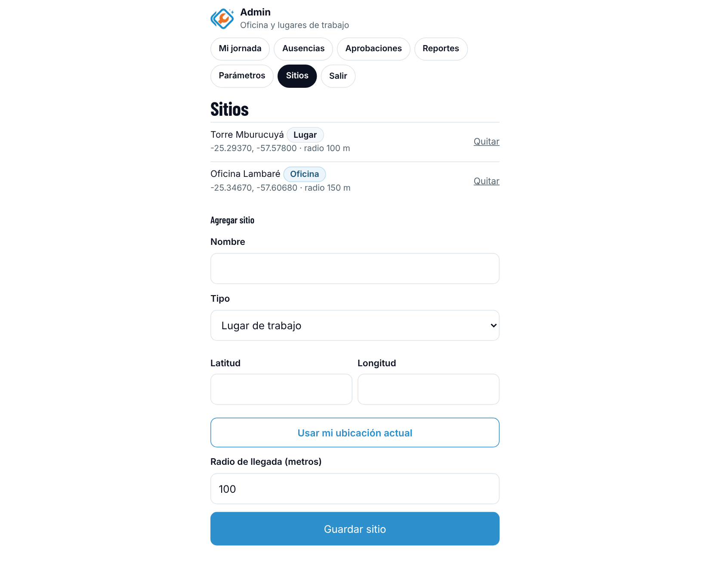
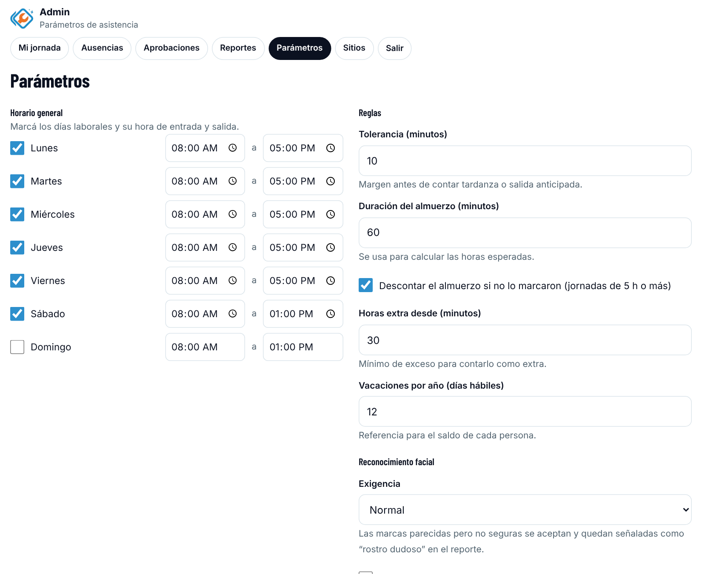
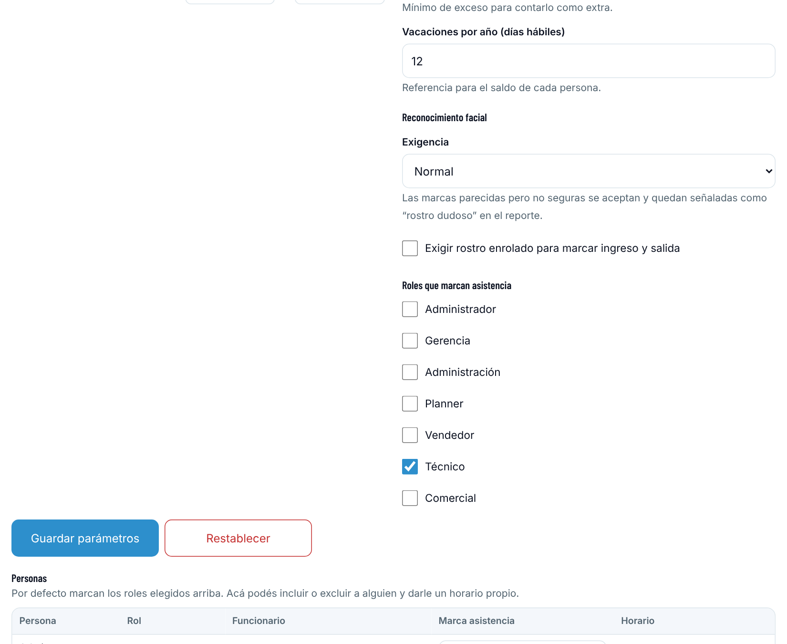
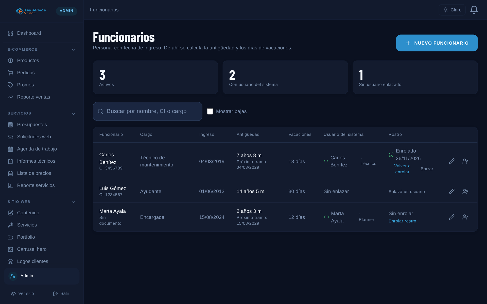
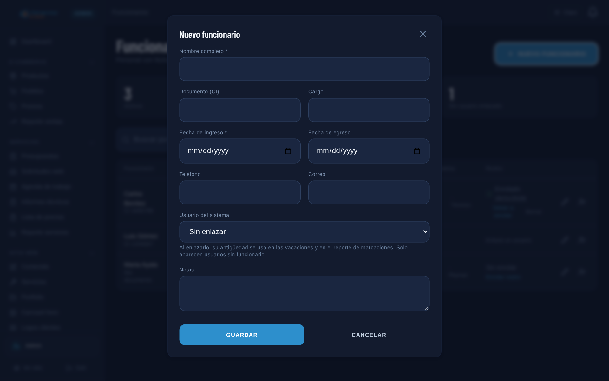
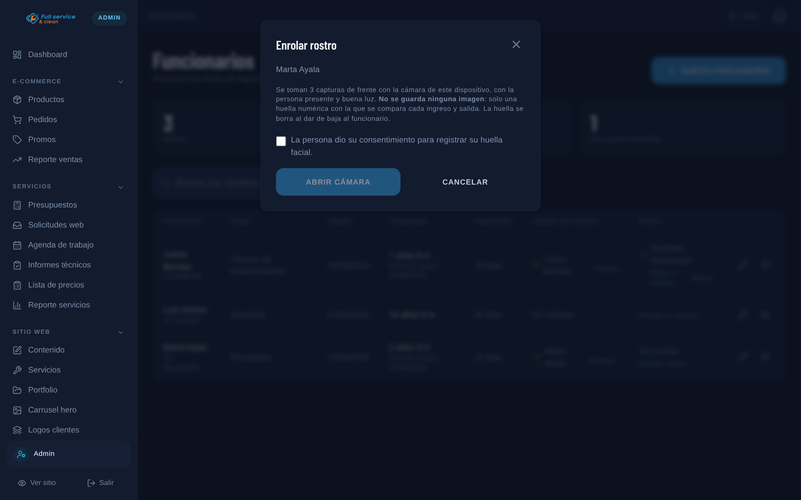
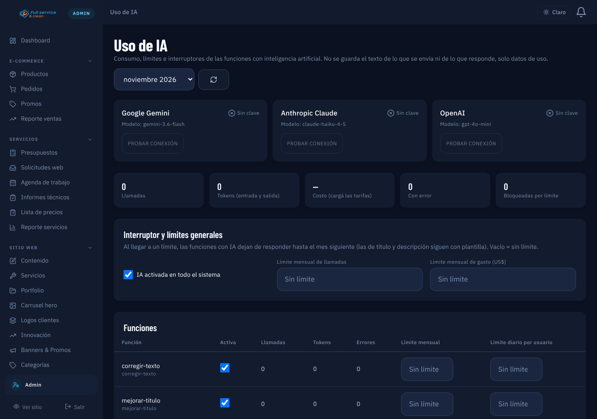

# Guía de uso · Administración

**App de Marcación · Full Service & Clean**

Esta guía es para quien deja el sistema funcionando: cargar los lugares, definir horarios y reglas, dar de alta a los funcionarios, **enrolar su rostro** y mantener todo al día. Se hace una vez al comienzo y después solo cuando algo cambia.

> Los nombres y datos de las capturas son de ejemplo.
> Necesitás un usuario con permiso de **configuración** y de **gestión de usuarios** (rol administrador o administración).

---

## Orden recomendado de puesta en marcha

1. **Sitios:** corregir la oficina y cargar los lugares de trabajo.
2. **Parámetros:** horarios, tolerancia, almuerzo, vacaciones y quién marca asistencia.
3. **Usuarios:** que cada persona tenga su usuario (menú *Usuarios* del admin).
4. **Funcionarios:** cargar la fecha de ingreso y enlazar cada uno con su usuario.
5. **Enrolar el rostro** de cada funcionario.
6. Recién cuando **todos** estén enrolados, activar *Exigir rostro enrolado*.
7. **Probar con un teléfono**: marcar una jornada completa de punta a punta.

---

## 1. Sitios: oficina y lugares de trabajo

**Marcación → Sitios** (o `Sitios` en el menú de arriba de la app).

| | |
|---|---|
|  | Cada sitio tiene un **nombre**, sus **coordenadas** y un **radio de llegada** en metros.  **Agregar un sitio** 1. Ubicate físicamente en el lugar con tu teléfono. 2. Completá el **Nombre** y el **Tipo** (*Lugar de trabajo* u *Oficina*). 3. Tocá **Usar mi ubicación actual** para completar latitud y longitud. 4. Definí el **Radio de llegada** (entre 30 y 1000 m; 100 m es un buen punto de partida). 5. **Guardar sitio**.  **Quitar** un sitio lo oculta de las listas pero conserva el historial. |

**Importante:** el sistema trae una **oficina por defecto** con coordenadas **aproximadas**. Corregí sus coordenadas (cargando la oficina real) apenas arranques. El trabajador solo puede marcar ingreso y salida dentro del radio de la oficina.

---

## 2. Parámetros

**Marcación → Parámetros.** Cualquier cambio se aplica con **Guardar parámetros**. **Restablecer** vuelve a los valores iniciales (sin guardar hasta que toques Guardar).

| | |
|---|---|
|  | **Horario general:** marcá los días laborales y poné la hora de entrada y de salida de cada día. Por defecto: lunes a viernes 08:00–17:00 y sábado 08:00–13:00. Si el sábado no es laboral en tu empresa, desmarcalo: de lo contrario, quien no marque ese día figurará ausente. |
|  | **Reglas** - **Tolerancia:** minutos de gracia antes de contar una tardanza o una salida anticipada. - **Duración del almuerzo:** se usa para calcular las horas esperadas. - **Descontar el almuerzo si no lo marcaron:** resta el tiempo de almuerzo automáticamente (jornadas de 5 horas o más). - **Horas extra desde:** mínimo de exceso para contar horas extra. - **Vacaciones por año:** días hábiles de referencia cuando una persona no tiene fecha de ingreso cargada. - **Reconocimiento facial:** ver el punto 4. - **Roles que marcan asistencia:** los roles tildados deben marcar (por defecto, técnicos). |

### Personas: excepciones individuales

Más abajo, en **Personas**, podés:

- Elegir si alguien **marca asistencia**: *Según su rol*, *Sí* o *No*. Sirve para incluir a un administrativo o excluir a alguien.
- Darle un **horario propio** (por ejemplo, un turno distinto): tocá **Horario … · editar**, cambiá los días y **Guardar horario propio**. **Usar el general** vuelve al horario común.

### Feriados

Al final de Parámetros está la lista de **Feriados**. Vienen cargados los feriados nacionales de Paraguay 2026 y 2027. Para otro año, elegí el **Año**, la **Fecha**, el **Nombre** y tocá **Agregar feriado**. Con **Quitar** lo sacás.

Un feriado hace que el día no cuente como falta. Si alguien trabaja ese día, todo el tiempo cuenta como hora extra.

---

## 3. Funcionarios

**Menú del admin → RRHH → Funcionarios.** (El legajo completo, los sueldos y la planilla están en la *Guía de RRHH*.)

| | |
|---|---|
|  | Es el listado del personal con su **fecha de ingreso**, la **antigüedad** (años y meses), los **días de vacaciones** que les corresponden y el **usuario del sistema** enlazado. Arriba ves cuántos están activos y cuántos tienen usuario. |
|  | **Dar de alta:** **Nuevo funcionario** → completá el nombre, la **fecha de ingreso** (obligatoria) y, si querés, documento, cargo, teléfono, correo y notas. En **Usuario del sistema** elegí el usuario de esa persona: así su antigüedad se usa en vacaciones y reportes. Solo aparecen usuarios que todavía no tienen funcionario. |

**Vacaciones por antigüedad:** el sistema aplica **12 días hábiles** hasta 5 años, **18** entre 5 y 10 años y **30** desde 10 años de antigüedad. La lista te muestra además la fecha del próximo cambio de tramo.

**Editar** (lápiz): cambia cualquier dato. **Dar de baja** (ícono de persona con cruz): la persona queda inactiva y se conserva su historial; la fecha de egreso se completa con el día de hoy y **se borra su huella facial**. Para ver las bajas, tildá **Mostrar bajas**; se reactivan desde Editar → **Activo**.

---

## 4. Enrolar el rostro

El enrolamiento registra, **una sola vez**, cómo es el rostro de cada funcionario. Después, en cada ingreso y salida, el sistema compara contra esa primera huella.

**No se guarda ninguna imagen.** Solo se guarda una huella numérica.

| | |
|---|---|
|  | 1. En **Funcionarios**, en la fila de la persona, tocá **Enrolar rostro** (el funcionario tiene que tener un usuario enlazado). 2. **Tildá el consentimiento**: *La persona dio su consentimiento para registrar su huella facial.* Sin eso no se abre la cámara. 3. Tocá **Abrir cámara**. 4. Con **la persona presente**, mirando al frente y con **buena luz**, el sistema toma **3 capturas**. Entre una y otra le pide que mueva un poco la cabeza y vuelva a mirar al frente. 5. Al terminar, la fila pasa a **Enrolado** con la fecha. |

- **Volver a enrolar** reemplaza la huella (útil si la persona cambió mucho o la app la rechaza seguido).
- **Borrar** elimina la huella; esa persona tendrá que enrolarse de nuevo.
- Hacelo con la **cámara del dispositivo que estés usando** (podés usar tu computadora con webcam o un teléfono) y sin gorra ni lentes oscuros.
- Si las 3 capturas no parecen de la misma persona (mala luz, movimiento), el sistema lo avisa y hay que repetir.

### Exigencia del reconocimiento (en Parámetros)

| Opción | Cuándo usarla |
|---|---|
| **Estricta** | Máxima seguridad; puede pedir más reintentos con mala luz. |
| **Normal** | Punto de partida recomendado. |
| **Flexible** | Tolera mala luz y cámaras flojas, pero es menos segura. |

Las marcas **parecidas pero no seguras** se aceptan y quedan señaladas como **Rostro dudoso** en los reportes. Las **claramente distintas** se rechazan.

**Exigir rostro enrolado para marcar ingreso y salida:** si está tildado, quien no esté enrolado **no puede marcar** ingreso ni salida. Activalo **recién cuando todos estén enrolados**; si no, nadie podría entrar. Con la opción apagada, las marcas de quien no esté enrolado se aceptan pero quedan señaladas como *Sin rostro enrolado*.

**Cómo ajustarlo:** durante la primera semana mirá en los reportes cuántas alertas de **Rostro dudoso** aparecen. Si son muchas en personas que sí son ellas, pasá a *Flexible* o volvé a enrolarlas con mejor luz; si te parece permisivo, pasá a *Estricta*.

---

## 5. Permisos: quién ve qué

| Pantalla | Quién puede usarla |
|---|---|
| Mi jornada y Ausencias | Cualquier usuario con sesión |
| Aprobaciones | Administrador, administración, gerencia, planner |
| Reportes (y PDF) | Administrador, administración, gerencia, planner, vendedor, comercial |
| Parámetros y Sitios | Administrador, administración |
| Funcionarios y RRHH (en el admin) | Administrador, administración (permiso **RRHH**) |

Cambios de rol o permisos: menú **Usuarios** del admin.

---

## 6. Tareas de mantenimiento

| Cuándo | Qué hacer |
|---|---|
| **Entra una persona nueva** | Crear su usuario → cargarla en *Funcionarios* con su fecha de ingreso y usuario → **enrolar su rostro**. |
| **Se va una persona** | *Funcionarios* → **Dar de baja**. Se desactiva y se borra su huella. |
| **Cambia el horario de la empresa** | *Parámetros* → editar el **Horario general** → Guardar. **Ojo:** los reportes se calculan con los parámetros vigentes, así que un cambio también recalcula los meses anteriores. |
| **Cambia el horario de una persona** | *Parámetros → Personas* → **Horario propio**. |
| **Nuevo año** | Cargar los **feriados** que falten. |
| **Nuevo lugar de trabajo** | *Sitios* → agregarlo estando en el lugar. |
| **Alguien es rechazado seguido** | Volver a **enrolar** su rostro con buena luz, o pasar la exigencia a *Flexible*. |
| **Fin de mes** | Sacar el **PDF mensual** (Reportes) y hacerlo firmar. |

## 7. Privacidad

- **No se guardan imágenes del rostro.** Solo una huella numérica, ligada al usuario, que se borra al dar de baja.
- La **foto del equipo de seguridad** sí se guarda, porque el encargado la necesita para aprobar. Puede mostrar a la persona.
- La huella facial es un **dato sensible**: conseguí el **consentimiento escrito** de cada funcionario antes de enrolarlo y definí cuánto tiempo se conserva. Usá el formato **Consentimiento de rostro** (`04-consentimiento-rostro`, en Word y PDF) y leé sus notas (`04-consentimiento-notas`). El sistema pide tildar el consentimiento, pero no lo reemplaza.
- Los cambios en funcionarios, el enrolamiento y el borrado de huellas quedan en el **Log de cambios** del admin.

## 8. Uso de IA

**Menú del admin → Sistema → Uso de IA.** Muestra cuánto se usa la inteligencia artificial del sistema y permite ponerle límites.

| |
|---|
|  |

- **Proveedores:** si cada clave (Gemini, Claude, OpenAI) está configurada y **Probar conexión** para comprobar que funciona. Nunca se muestra la clave.
- **Resumen del mes:** llamadas, tokens, costo estimado, errores y llamadas bloqueadas. Elegí otro mes arriba a la derecha.
- **Interruptor y límites generales:** apagá la IA en todo el sistema, o poné un tope mensual de llamadas o de gasto (en US$). Vacío = sin límite.
- **Funciones:** cada función con IA (corregir texto, mejorar título, descripciones de productos, borrador de presupuesto, ajustes por chat) se puede **apagar** o limitar por mes y **por usuario por día**.
- **Tarifas por modelo:** para estimar el costo, cargá el precio vigente de cada modelo (US$ por millón de tokens, lo publica cada proveedor). **Sin tarifa, ese modelo no suma al costo.** Es una estimación, no la factura.
- **Últimas llamadas:** quién usó qué, cuántos tokens y si hubo error o bloqueo. Filtrá por estado.
- **Conservación de registros:** los registros de uso se **depuran solos** pasado el plazo que definas (180 días por defecto, mínimo 7), una vez por día. Ves cuándo fue la última depuración. **Depurar ahora** los borra al instante (pide confirmación). Al borrarse, las estadísticas de esos meses dejan de estar disponibles.
- Tocá **Guardar configuración** para aplicar los cambios.

**Qué pasa cuando algo está apagado o llegó al límite:** las funciones que necesitan IA avisan el motivo. *Mejorar título* y *descripciones de productos* siguen funcionando con una plantilla sin IA.

**Privacidad:** el sistema **no guarda el texto** de lo que se consulta ni de lo que responde la IA, solo datos de uso. Los cambios de configuración quedan en el Log de cambios.

---

## 9. Preguntas frecuentes

**Una persona no puede marcar ingreso, ¿qué reviso?** (1) Que su usuario esté activo. (2) Que esté dentro del radio de la oficina. (3) Si *Exigir rostro enrolado* está activo, que esté enrolada. (4) Que la oficina esté bien cargada en *Sitios*.

**Alguien figura ausente y sí vino.** Verificá en el *Detalle por día* si hay marcas. Si no hay, no marcó; hoy la corrección manual de marcas no existe en la app.

**¿Por qué el reporte no muestra a alguien?** Porque su rol no está en *Roles que marcan asistencia* y no tiene jornadas. Activalo en *Parámetros → Personas*.

**¿Se gastó mucho en IA este mes?** Mirá *Sistema → Uso de IA*. Si querés un tope, definí el límite mensual de gasto (necesita las tarifas cargadas).

**¿Se puede cambiar el horario de un solo día?** No, el horario es por día de la semana. Para un día especial, cargá un **feriado** o una **ausencia**.

**¿Qué pasa con las vacaciones si no cargo la fecha de ingreso?** Se usan los **días por año** de Parámetros para todos, sin considerar antigüedad.
