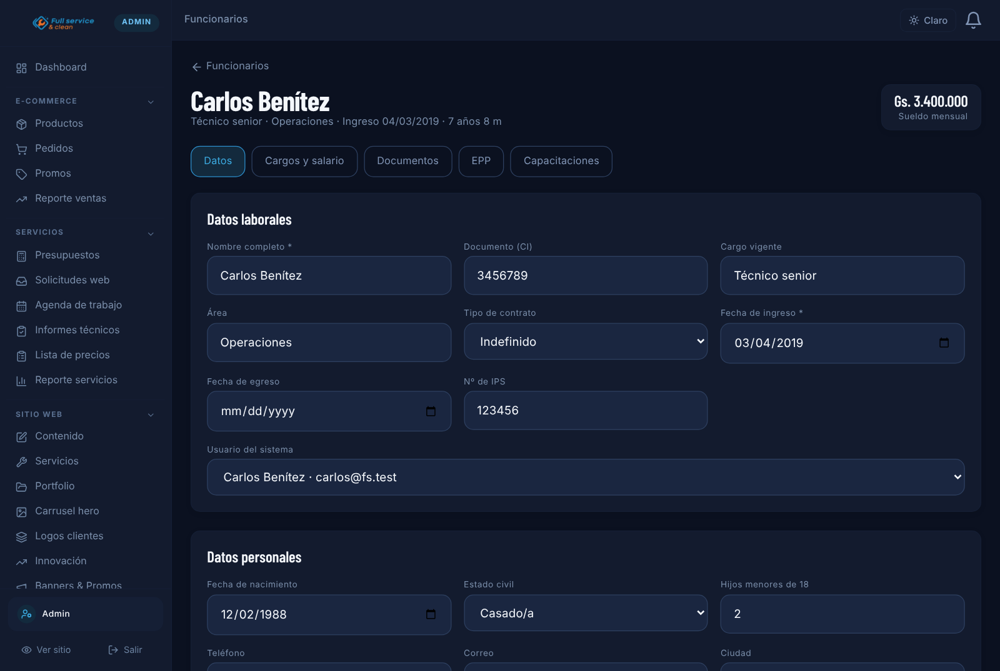
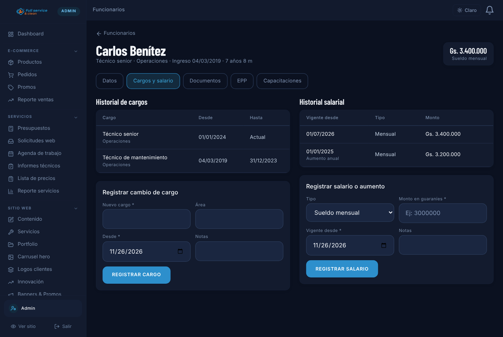
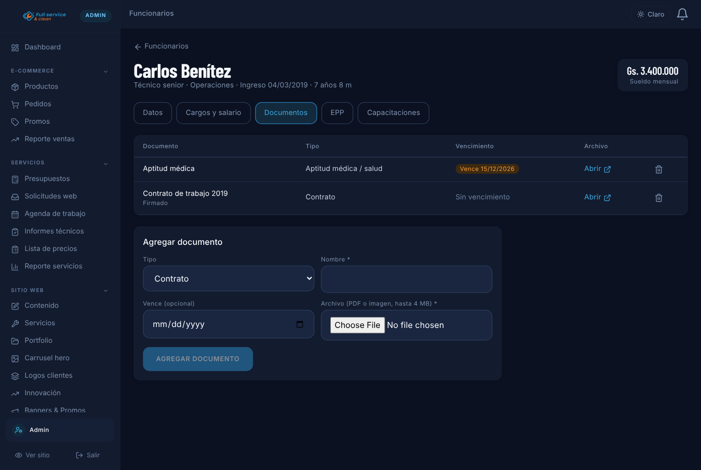
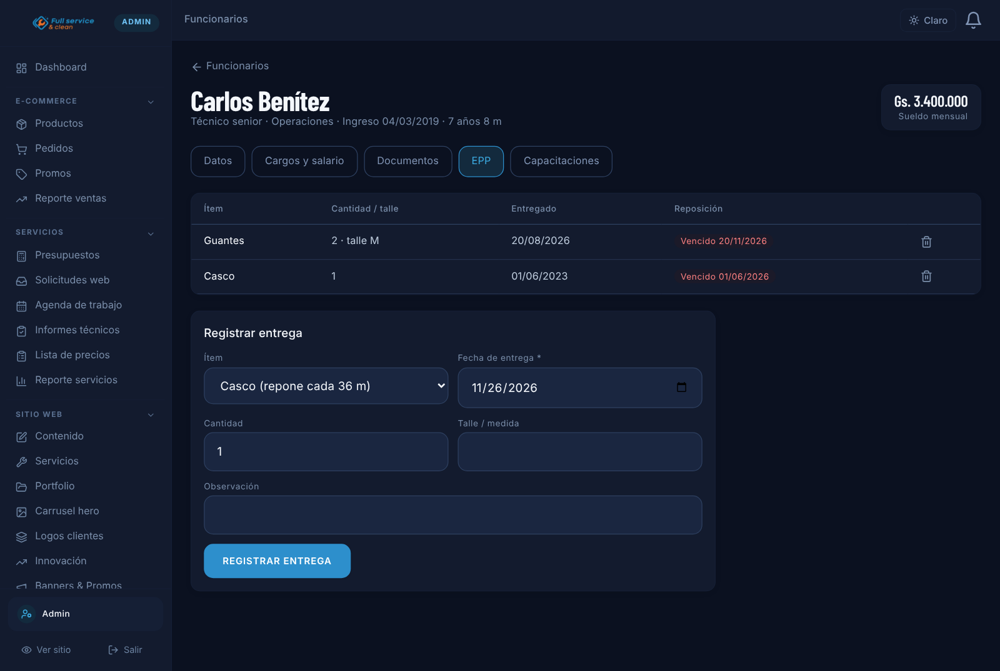
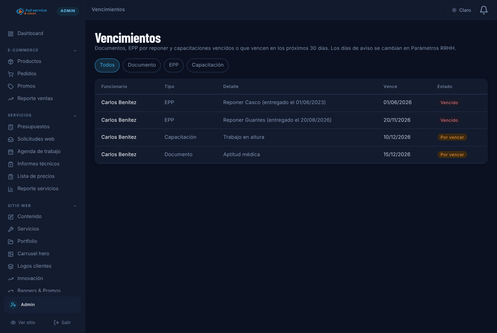
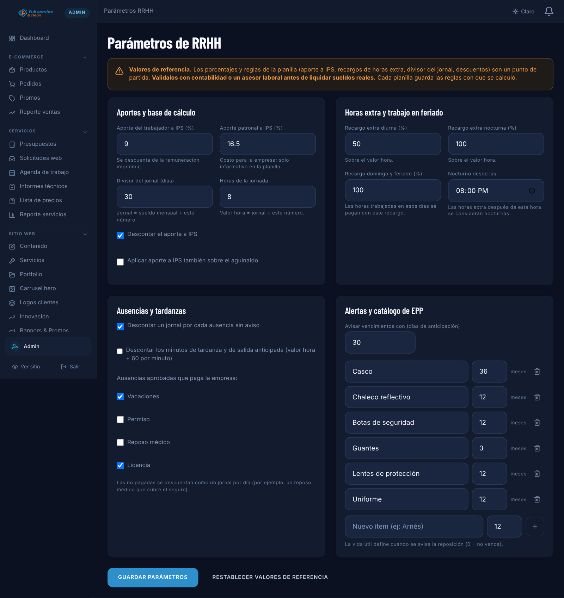
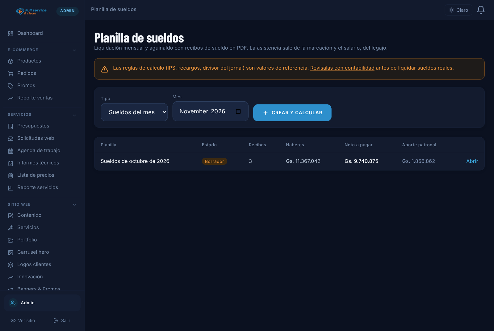
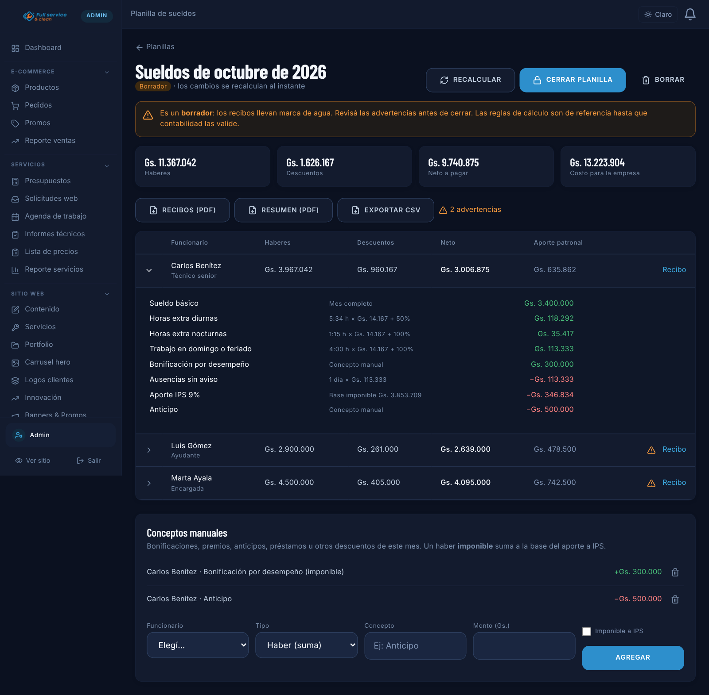
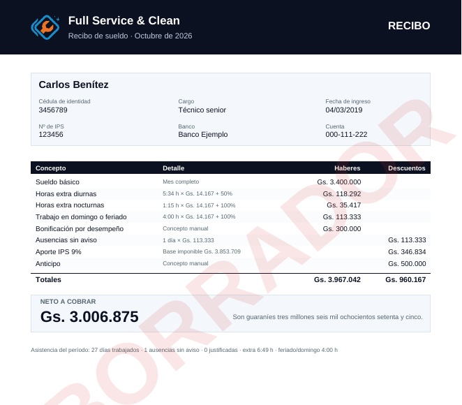

# Guía de uso · RRHH

**Legajos, vencimientos y planilla de sueldos · Full Service & Clean**

Con el módulo de RRHH llevás el legajo de cada funcionario, controlás los vencimientos (documentos, equipo de seguridad y capacitaciones) y liquidás los sueldos del mes y el aguinaldo con sus recibos en PDF.

> Los nombres, montos y fechas de las capturas son de ejemplo.
> **Importante:** las reglas de cálculo de la planilla (aporte a IPS, recargos de horas extra, jornal, descuentos) son **valores de referencia**. Antes de liquidar sueldos reales, validalas con contabilidad o con un asesor laboral (ver el punto 8, *Cómo se calcula*).

**Quién puede usarlo:** los roles con el permiso **RRHH** (administrador y administración). Los sueldos son datos sensibles: ningún otro rol los ve. El permiso se otorga desde *Usuarios → Roles*.

**Dónde está:** en el menú de la izquierda, grupo **RRHH**: *Panel RRHH, Funcionarios, Vencimientos, Planilla de sueldos, Parámetros RRHH* y *Asistencia y marcación*.

---

## 1. Puesta en marcha (en este orden)

1. **Parámetros RRHH:** revisá las reglas de la planilla y el catálogo de EPP (punto 5).
2. **Funcionarios:** cargá a cada persona con su fecha de ingreso y enlazala con su usuario del sistema.
3. **Legajo → Cargos y salario:** cargá el **salario** de cada funcionario. Sin salario no se puede liquidar.
4. **Marcación → Parámetros → Personas:** verificá quién marca asistencia. Quien no marca debe estar excluido para que no se le descuenten ausencias.
5. Cuando haya un mes completo de asistencia, **creá la planilla** (punto 6).

---

## 2. Panel RRHH

| |
|---|
|  |

El panel resume el estado del personal:

- **Avisos naranja** (arriba): lo que hay que atender: vencimientos sin renovar, solicitudes de ausencia por resolver, funcionarios sin salario, sin usuario enlazado o sin rostro enrolado. Tocá un aviso para ir directo.
- **Indicadores:** funcionarios activos (con altas y bajas de los últimos 30 días), masa salarial mensual, ausencias y tardanzas del mes y horas extra.
- **Listas:** próximos vencimientos, cumpleaños de los próximos 30 días, cambios de tramo de vacaciones y últimas planillas.

---

## 3. Legajo del funcionario

Entrá desde **Funcionarios** tocando el nombre. El legajo tiene cinco pestañas.

### Datos

| |
|---|
|  |

Datos laborales (cargo, área, tipo de contrato, fechas de ingreso y egreso, nº de IPS, usuario enlazado), personales (nacimiento, estado civil, hijos menores, dirección, teléfono), contacto de emergencia y datos bancarios. Tocá **Guardar datos** al terminar.

### Cargos y salario

| |
|---|
|  |

- **Historial de cargos:** para registrar un ascenso o cambio, completá **Registrar cambio de cargo**. El cargo anterior se cierra solo el día anterior y pasa a ser el cargo vigente.
- **Historial salarial:** cada aumento es un **nuevo registro con su fecha de inicio**; no se edita el anterior. Elegí el tipo: **sueldo mensual** o **jornal** (pago por día). Para un mes, vale el último salario con fecha de inicio anterior o igual al fin del mes.
- No se puede borrar un salario si ya hay planillas cerradas de esa persona.
- Los cambios de salario quedan en el **Log de cambios** del admin (antes, después y quién).

### Documentos

| |
|---|
|  |

Subí contratos, cédula, certificados, aptitud médica, antecedentes u otros (PDF o imagen, hasta 4 MB). Si el documento vence (por ejemplo, la aptitud médica), cargá la fecha: el sistema avisa antes.

### EPP (equipo de seguridad)

| |
|---|
|  |

Registrá cada **entrega**: ítem, cantidad, talle y fecha. La **fecha de reposición** se calcula sola con la vida útil del ítem (por ejemplo, casco cada 36 meses, guantes cada 3). Cuando vence, aparece en Vencimientos.

### Capacitaciones

Registrá cursos y certificaciones con fecha, horas, entidad y, si tiene vigencia, el vencimiento. Podés adjuntar el certificado.

---

## 4. Vencimientos

| |
|---|
|  |

Reúne en una sola lista lo **vencido** y lo que **vence pronto** (por defecto, en 30 días): documentos, EPP por reponer y capacitaciones de funcionarios activos. Filtrá por tipo. Tocá el nombre para ir al legajo y renovar.

De cada EPP solo cuenta la **entrega más reciente**: al registrar una reposición, el aviso viejo desaparece.

---

## 5. Parámetros de RRHH

| |
|---|
|  |

- **Aportes y base de cálculo:** porcentaje de IPS del trabajador y de la empresa, divisor del jornal y horas de la jornada.
- **Horas extra y feriado:** recargos y la hora desde la que las extras son nocturnas.
- **Ausencias y tardanzas:** si se descuentan, y qué ausencias aprobadas paga la empresa (vacaciones, permiso, reposo, licencia).
- **Alertas y catálogo de EPP:** con cuántos días de anticipación se avisa y la lista de ítems con su vida útil.

Cada planilla **guarda las reglas con que se calculó**: cambiar un parámetro no altera planillas ya cerradas.

---

## 6. Planilla de sueldos

### Antes de empezar

Verificá que:

- Todos los funcionarios tienen **salario** cargado.
- La **asistencia del mes está completa**: todos marcaron y las ausencias aprobadas están cargadas.
- Los **feriados** del mes están en Marcación → Parámetros.
- Los funcionarios que no marcan asistencia están **excluidos** en Marcación → Parámetros → Personas.

### Crear la planilla

| |
|---|
|  |

1. Entrá a **Planilla de sueldos**.
2. Elegí **Sueldos del mes**, el **mes**, y tocá **Crear y calcular**.
3. Se abre la planilla en **borrador** con un recibo por funcionario.

### Revisar

| |
|---|
|  |

- Arriba: haberes, descuentos, **neto a pagar** y **costo para la empresa** (incluye el aporte patronal).
- Tocá la flecha de cada fila para ver **cada concepto con su cuenta**: por ejemplo, *5:34 h × Gs. 14.167 + 50%*.
- El triángulo naranja indica **advertencias**: jornadas sin salida, ausencias sin aviso para verificar, falta de salario, ingreso o baja en el mes, etc. **Leelas todas antes de cerrar.**
- **Recalcular** vuelve a calcular con los datos actuales (por ejemplo, después de corregir la asistencia).

### Conceptos manuales

Al final de la planilla agregás lo que no sale de la asistencia:

- **Haber:** bonificaciones, premios, comisiones. Si es **imponible**, suma a la base del aporte a IPS.
- **Descuento:** anticipos, préstamos, embargos, otros.

Elegí el funcionario, el concepto y el monto. La planilla se recalcula sola.

### Recibos y reportes

- **Recibos (PDF):** un recibo por página para todos, o **Recibo** en la fila de una persona. Trae los conceptos, el neto con su monto **en letras**, y espacio para firmas. En borrador llevan marca de agua *BORRADOR*.
- **Resumen (PDF):** una hoja con todos los funcionarios, totales y costo para la empresa.
- **Exportar CSV:** para abrir en Excel.

| |
|---|
|  |

### Cerrar la planilla

1. Tocá **Cerrar planilla**. Se recalcula por última vez con los datos actuales.
2. Si algún recibo tiene **muchas ausencias sin aviso** (5 o más), el sistema te pide **confirmarlo**: suele indicar que no se marcó asistencia ese mes. Revisalo antes de aceptar.
3. Al cerrar, la planilla queda **fija** (sin marca de agua en los recibos): no se puede recalcular, ni cambiar sus conceptos, ni borrar.
4. Queda registrado quién la cerró y cuándo.

**Reabrir:** si hay que corregir algo, usá **Reabrir**; vuelve a borrador. Queda en el Log de cambios. No se puede reabrir un mes si ya hay un aguinaldo cerrado de ese año.

---

## 7. Aguinaldo

1. **Cerrá primero todas las planillas mensuales del año.**
2. En **Planilla de sueldos**, elegí **Aguinaldo**, el **año** y tocá **Crear y calcular**.

El aguinaldo es **1/12 de las remuneraciones (haberes) del año**, según las planillas mensuales cerradas. Quien ingresó a mitad de año cobra la parte proporcional automáticamente. Si faltan meses por cerrar, el sistema lo advierte.

Por defecto no se descuenta aporte a IPS sobre el aguinaldo (se puede cambiar en Parámetros).

---

## 8. Cómo se calcula (ejemplo)

Funcionario con **sueldo mensual de Gs. 3.400.000** (reglas de referencia):

| Dato | Cálculo |
|---|---|
| **Jornal** | 3.400.000 ÷ 30 = **Gs. 113.333** |
| **Valor hora** | 113.333 ÷ 8 = **Gs. 14.167** |
| **Hora extra diurna** | 14.167 × 1,5 = Gs. 21.250 por hora |
| **Hora extra nocturna** (después de las 20:00) | 14.167 × 2 = Gs. 28.333 por hora |
| **Trabajo en domingo o feriado** | 14.167 × 2 = Gs. 28.333 por hora |
| **Ausencia sin aviso** | se descuenta **un jornal** (Gs. 113.333) por día |
| **Aporte IPS del trabajador** | **9 %** de la remuneración imponible |
| **Neto** | haberes − descuentos |

Otras reglas:

- **Mes completo:** se paga el sueldo entero aunque el mes tenga 28 o 31 días. Si ingresó o se fue en el mes, se paga **proporcional a los días de vínculo**.
- **Jornalero:** cobra el valor del jornal por cada día trabajado, más los feriados y las ausencias que paga la empresa.
- **Vacaciones:** se pagan normalmente (no se descuentan). **Permiso** y **reposo médico** se descuentan por defecto como no pagados (se puede cambiar).
- **Tardanzas:** por defecto **no se descuentan**; se activa en Parámetros.
- **Base imponible de IPS:** sueldo + extras + haberes imponibles − descuentos por ausencia y tardanza.
- Cada monto se **redondea al guaraní**.

### Qué NO calcula el sistema
Hay que cargarlo como **concepto manual** si corresponde: bonificación familiar, préstamos en cuotas, embargos, **liquidación final** (vacaciones no gozadas, preaviso, indemnización), subsidios de IPS por reposo, retenciones y otros descuentos de ley. Cada **baja** en un mes lo advierte en el recibo.

---

## 9. Problemas frecuentes

| Qué pasa | Qué hacer |
|---|---|
| **"Sin salario cargado"** | Cargalo en el legajo → *Cargos y salario* y recalculá. |
| **Muchas ausencias sin aviso a alguien que sí vino** | No marcó asistencia ese mes. Verificá en *Asistencia y marcación*. Si esa persona no marca, excluila en Marcación → Parámetros → Personas. |
| **"Sin usuario enlazado o sin asistencia"** | No se calcularon ausencias, tardanzas ni extras. Enlazá su usuario en el legajo, o cargá lo que corresponda como concepto manual. |
| **"Jornadas sin salida"** | Alguien no marcó la salida. Sus horas no se calcularon. Corregilo con la persona y recalculá. |
| **No puedo cerrar: neto negativo** | Los descuentos superan los haberes. Revisá los conceptos manuales. |
| **No aparece un funcionario en la planilla** | Solo entran quienes tenían vínculo en ese mes (ingreso antes del fin y egreso después del inicio). |
| **La planilla del mes en curso** | Se calcula con la asistencia hasta hoy y lo avisa. Recalculá al terminar el mes. |
| **Cambié un parámetro y una planilla cerrada no cambió** | Es lo esperado: cada planilla guarda sus reglas. Reabrila y recalculá si querés aplicar los nuevos. |

## 10. Preguntas frecuentes

**¿Quién ve los sueldos?** Solo los roles con permiso RRHH. Los cambios de salario quedan registrados.

**¿Puedo corregir una planilla cerrada?** Sí, reabriéndola (queda registrado). Conviene evitarlo una vez pagada.

**¿Puedo cargar el pago de una quincena?** No. El sistema liquida por mes completo.

**¿Se pueden pagar horas extra de un mes en otro?** Cargalas como concepto manual en el mes que corresponda.

**¿Las reglas son las del Código del Trabajo?** Son valores de referencia razonables, **no una verificación legal**. Que contabilidad o un asesor laboral las revise antes de usarlas para pagar.
